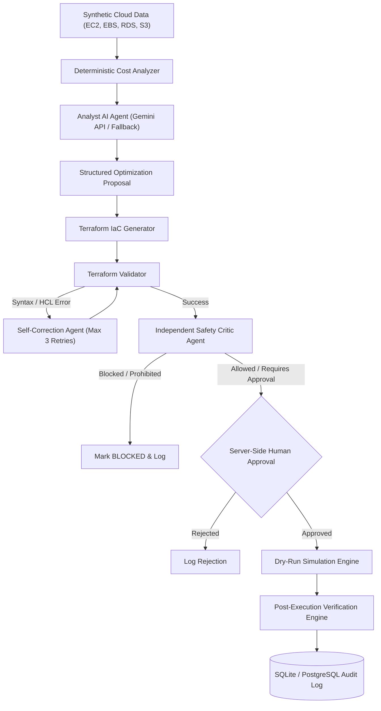

# Autonomous Cloud Cost Optimization & Infrastructure Remediation Agent ⚡

An enterprise-grade, portfolio-level Agentic AI system that detects unnecessary cloud expenditure and safely executes closed-loop infrastructure remediation through **deterministic telemetry analysis, Gemini-powered reasoning, controlled Terraform IaC generation, self-correcting validation loops, independent safety critic policies, server-side human approval enforcement, and dry-run execution verification.**

---

## 🌟 Key Differentiators

Unlike generic chatbots or read-only cloud cost dashboards, this project implements **Closed-Loop Infrastructure Remediation**:

1. **Deterministic Analytics First**: Mathematical utilization thresholds and cost equations are computed strictly via deterministic code — never via LLM calculation.
2. **Gemini 2.5 Multi-Agent Reasoning**: Contextual evaluation, architectural trade-offs, confidence scores, and structured Pydantic proposals.
3. **Controlled Terraform Generation**: Automated generation of secure, allowlisted HCL templates.
4. **Self-Correction & Bounded Retry Loop**: Automated syntax and validation error analysis with up to 3 bounded repair attempts.
5. **Independent Safety Critic**: Enforces zero automated production deletions, CAB requirements for critical databases, and detection of privilege escalation or public exposure.
6. **Server-Enforced Human-in-the-Loop Gate**: All infrastructure mutations mandate explicit server-validated operator approval. No approval = zero execution.
7. **Zero-Mutation Dry-Run Simulation & Verification**: Safe AWS-isolated simulation generating before/after state diffs and post-execution telemetry drift detection.
8. **Immutable Audit Ledger**: Comprehensive persistence of every agent run, IaC version, validation attempt, safety evaluation, approval, and simulation.

---

## 🏛️ System Architecture



---

## 🚀 Quick Start Guide

### 1. Requirements
- Python 3.12+
- Web browser

### 2. Environment Setup
```bash
# Clone or open the workspace
cd cloud-finops-agent

# Create virtual environment (optional)
python -m venv venv
venv\Scripts\activate

# Install dependencies
pip install -r requirements.txt # or pip install fastapi uvicorn pydantic sqlalchemy pytest httpx python-dotenv google-genai langgraph
```

### 3. Configure `.env`
Copy `.env.example` to `.env`:
```bash
cp .env.example .env
```
*(Optional: Add your `GEMINI_API_KEY`. If left empty, the system automatically uses the built-in Deterministic Rule Fallback engine with zero interruption!)*

### 4. Run the Application
```bash
python scripts/run_backend.py
```
Open **[http://localhost:8000](http://localhost:8000)** in your browser to access the complete interactive SaaS dashboard.

API Swagger documentation is accessible at **[http://localhost:8000/docs](http://localhost:8000/docs)**.

---

## 🧪 Running Automated Tests & Benchmarks

### Backend Test Suite
```bash
python -m pytest backend/tests -v
```
*Executes all 12 unit and integration tests (Agents, LangGraph workflow, Safety Critic, Approval Enforcement, Simulation Engine, and FastAPI endpoints).*

### Empirical Benchmark Evaluation
```bash
python evaluation/run_eval.py
```
*Measures recommendation accuracy, IaC validation rate, safety violation detection, false positive rates, and latency across multi-cloud test scenarios.*

---

## 📁 Repository Structure

```
cloud-finops-agent/
├── backend/
│   ├── app/
│   │   ├── core/         # Settings, Security sanitization, Allowlist policies
│   │   ├── database/     # SQLAlchemy Session, Models (Audit, Proposals, Simulations)
│   │   ├── schemas/      # Pydantic v2 Schemas
│   │   ├── services/     # Cost Analyzer, Dataset Loader, Simulator, Verifier
│   │   ├── agents/       # Analyst Agent, Terraform Agent, Validator, Corrector, Safety Critic
│   │   ├── workflows/    # LangGraph StateGraph Workflow & Conditional Edges
│   │   ├── api/          # FastAPI REST endpoints
│   │   ├── static/       # Embedded Dark-Navy SaaS React Dashboard
│   │   └── main.py       # FastAPI Application Entrypoint
│   └── tests/            # 12 Pytest unit & integration test files
├── frontend/             # Standalone React + TypeScript + Vite project
├── terraform/            # HCL Templates and Generated IaC files
├── data/                 # Realistic Synthetic Cloud Telemetry (EC2, EBS, RDS, S3)
├── evaluation/           # Evaluation dataset, runner script & benchmark reports
├── docs/                 # Architecture, Hinglish Student Guide, Interview Prep
├── scripts/              # Launch, Seeding, and Evaluation utilities
├── .env.example          # Environment variables template
├── docker-compose.yml    # Container orchestration configuration
├── Dockerfile            # Container build definition
└── README.md
```
