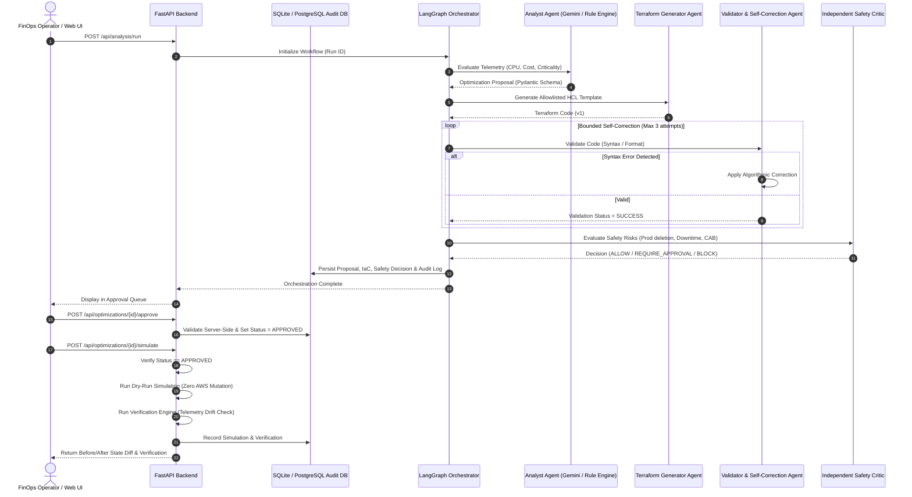
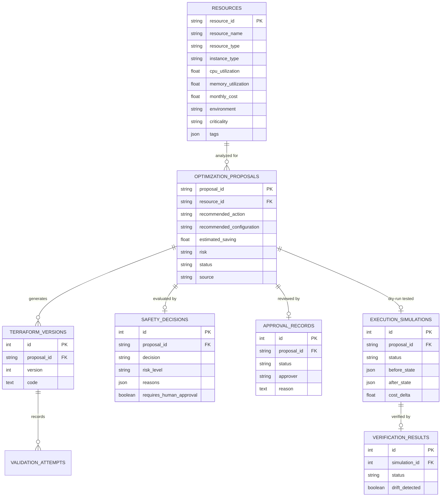

# System Architecture & Technical Specifications

## 1. Architectural Philosophy

Traditional FinOps systems function as passive observers: they ingest CloudWatch / CUR billing records and display charts. When actions are required, humans must manually formulate tickets, write Terraform, and navigate change approvals.

The **Autonomous Cloud FinOps Agent** bridges this gap by implementing **Closed-Loop Infrastructure Remediation** while maintaining strict enterprise safety boundaries:
1. **Never allow LLMs to perform arithmetic**: Telemetry thresholds (e.g. CPU < 15%, unattached EBS, memory buffers) and financial equations are deterministic.
2. **Never trust arbitrary code generation**: Terraform is emitted through allowlisted HCL templates.
3. **Never bypass human approval**: Mutations require an authenticated state change in the audit database.
4. **Independent Safety Review**: The Safety Critic is an adversarial evaluation gate isolated from the proposing agent.

---

## 2. Multi-Agent Communication Model

---

## 3. Database Schema Design & Relationships

